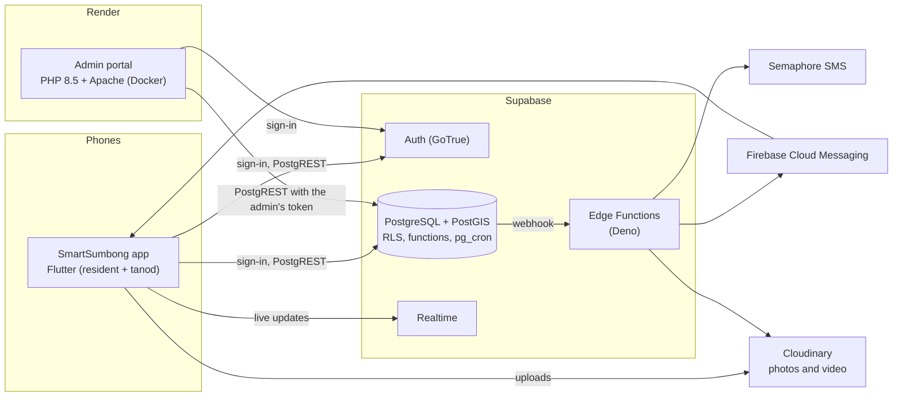

# SmartSumbong

A hybrid complaint and incident reporting system for **Barangay 183, Zone 20,
Villamor, Pasay City**. Residents file complaints from their phones, the
barangay reviews and dispatches them from a web portal, and tanods receive,
work and resolve them in the field, with every step recorded.

Capstone project of Group 12, Bachelor of Science in Information Technology,
Polytechnic University of the Philippines, College of Computer and
Information Sciences.

| | |
|---|---|
| Admin portal | https://smartsumbong-ph.onrender.com |
| Mobile app | Android APK (residents and tanods, one app) |
| Status | Final defense build, October 2026 |

## Scope

SmartSumbong handles **complaints**: noise, obstruction, waste, stray animals,
traffic, public safety, barangay services and the like. The emergency
dispatch feature was removed by unanimous panel direction: the app lists the
emergency hotlines instead of handling emergency response itself.

Three actors, and nobody else:

| Actor | Uses | Does |
|---|---|---|
| **Resident** | the app | registers with an ID, files complaints (photos, video, place, one or more concerns), follows each one on a timeline, talks to the barangay in the complaint's thread, rates the result, appeals or reopens |
| **Barangay Tanod** | the same app, signed in as a tanod | goes on and off duty, accepts or hands back dispatches, navigates to the place, posts updates with proof, asks to escalate, submits the resolution |
| **Barangay Admin** (secretary, kagawad, chairman) | the portal | verifies accounts, validates complaints, sets the deadline, dispatches a tanod, approves resolutions, escalates up the barangay (kagawad by committee, then the chairman) or to an outside office, reads the map, the dashboard and the report summary |

## What it does

- **The case lifecycle, end to end.** Filed → validated → assigned with a
  target date → accepted → on the way → arrived → resolved by the tanod →
  approved by the admin → rated by the resident. Rejections, appeals,
  reopening, deadline extensions (capped, with reasons), escalation and
  cancellation are all first-class states.
- **One handler per case.** The first admin to act handles the case; others
  see who has it and can take it over only with a reason.
- **A tamper-evident audit trail.** Every status change is appended to a
  hash-chained log the database itself can verify; complaints are never
  deleted.
- **The SMART engine.** Rule-based, not a model, and every result says why:
  an urgency score for each complaint (it reads Taglish), likely duplicates,
  the best tanod to send, deadline risk, recurring problems, storm mode, a
  priority queue and three briefings a day. See [docs/SMART.md](docs/SMART.md).
- **Maps.** Spatial Distribution: every complaint on a vector map of the
  barangay with heatmap, hotspots, flood and storm-surge zones, transit,
  air quality, safe points and street-level "Look around".
- **The Workspace.** A work board of every open case by stage, plus 120
  widgets each staff member picks for their own screen (weather, PAGASA and
  GDACS hazard watches, team posts, rosters, tools, RSS). See
  [docs/WIDGETS.md](docs/WIDGETS.md).
- **Barangay paperwork.** The Complaint Summary form, a single complaint on
  the barangay's letterhead, and the Certification of Lack of Jurisdiction,
  as PDFs.
- **Works offline where it matters.** The app keeps its last copy of every
  screen and queues a complaint filed without signal until it can send it.
- **English and Tagalog** everywhere, light and dark themes, accessible
  touch targets and contrast (WCAG AA).

## Architecture



The database is the system: every state change is a PostgreSQL function that
moves the status, writes the audit trail and notifies the people involved in
one transaction, and row-level security decides what each role can see. The
portal and the app are clients of it. [docs/ARCHITECTURE.md](docs/ARCHITECTURE.md)
explains each part.

## Stack

| Layer | Technology |
|---|---|
| Backend | Supabase: PostgreSQL 17, PostGIS, Auth, Realtime, Edge Functions (Deno 2.9), pg_cron, Vault |
| Admin portal | PHP 8.5 on Apache in Docker, no framework and no build step; own CSS (Figma design); MapLibre GL JS on OpenFreeMap vector tiles; Chart.js |
| Mobile app | Flutter 3.47 (Android; minimum Android 7.0); MapLibre; on-device ML Kit OCR (switched off) |
| Media | Cloudinary, SHA-256 signed uploads; identity photos private; location data stripped |
| Push | Firebase Cloud Messaging through the `send-dispatch-push` Edge Function; Crashlytics for app crashes |
| SMS | Semaphore through the `password-otp` Edge Function (built, switched off until credits are bought) |
| Hosting | Render (portal, Singapore), Supabase (database, Mumbai), GitHub Actions (CI, backups, deploys) |

## Repository layout

```
admin/                    The admin portal (PHP). One file per page.
  dashboard.php             figures for a month, SMART tiles
  workspace.php             the work board and the widget rail
  cases.php, case.php       Case Reports: the list, and one complaint with every admin action
  spatial.php, layers.php   Spatial Distribution: the map and its layers
  summary.php               Report Summary; complaint-summary.php and complaint-print.php are its PDFs
  certificate.php           Certification of Lack of Jurisdiction
  residents.php, personnel.php, retirement-requests.php   accounts and requests
  notifications.php, activity.php, settings.php, profile.php
  widgets.php, workspace-act.php, widget-view.php, hazards.php   the widgets' data, writes and preview
  login.php, forgot-password.php, reset-password.php, change-password.php, request-access.php
  includes/                 auth, the Supabase client, layout, i18n (t(en, fil)), page logic
  assets/                   css, js, icons, fonts, map styles and data, vendored libraries
mobile/
  core/                     shared Flutter package: auth, uploads, push, OCR, biometrics, offline cache
  resident/                 the SmartSumbong app; tanod screens under lib/tanod/
supabase/
  migrations/               0001–0133, applied in order, never edited once applied
  baseline/                 the whole schema as one generated file, proven equal to the migrations
  functions/                Edge Functions: delete-account, media-cleanup, password-otp,
                            send-dispatch-push, sign-upload
  tests/                    rolled-back database checks and the query performance budget
  seed.sql, config.toml     SLA guide hours and boundary; per-function JWT settings
docs/                     architecture, operations, incidents, schema, SMART, widgets, panel asks
tools/                    builders for the portal's map data (transit routes, safe points)
scripts/                  one-off maintenance scripts
.github/                  CI, security scanning, nightly backup, deploy, keep-awake; Dependabot
Dockerfile, .htaccess     the portal's image and Apache rules
index.php                 the landing page at the site root
run-dev-server.bat        the portal on this PC at http://127.0.0.1:8000/admin/
```

## Getting started

You need PHP 8.5, Flutter 3.47, Node 24, Deno 2.9 and the Supabase CLI 2.120
(the versions CI pins).

**The portal, locally**

```bash
cp .env.example .env          # fill in SUPABASE_URL and SUPABASE_PUBLISHABLE_KEY at least
php -S 127.0.0.1:8000 -t .    # or run-dev-server.bat on Windows
# open http://127.0.0.1:8000/admin/
```

It talks to whichever Supabase project `.env` names. Against production,
anything you click changes real data.

**The app**

```bash
cd mobile/resident
flutter run --dart-define-from-file=dart_defines.json
# or, with no backend at all, the real screens on demo data:
flutter run -d web-server --web-port 5000 -t lib/main_preview.dart
```

**The database**

```bash
supabase link --project-ref <ref>
supabase db push              # apply new migrations
```

A brand-new project can load `supabase/baseline/baseline.sql` instead of
replaying 125 migrations. [DEPLOY.md](DEPLOY.md) sets up every part from
nothing.

## Testing

| What | Command | In CI |
|---|---|---|
| Portal: parse, start, security headers, nonce CSP | `bash .github/scripts/portal-smoke.sh` | every push |
| Every English string has its Tagalog | `php .github/scripts/i18n-check.php` | every push |
| Page, script, stylesheet and photo size budgets | `bash .github/scripts/perf-budget.sh` | every push |
| App and core: analyzer, unit, widget and flow tests | `flutter analyze && flutter test` (in each package) | when `mobile/` changes |
| Release APK under 60 MB | `flutter build apk --release` | when `mobile/` changes |
| Edge Functions | `deno check supabase/functions/*/index.ts && deno lint supabase/functions && deno test --allow-env supabase/functions` | every push |
| Database: every migration, then every rolled-back check | `bash supabase/tests/local/run-local.sh` (needs PostgreSQL) | every push |
| Secrets, dependency advisories, CodeQL | the Security workflow | every PR, push and weekly |

## Documentation

| Document | For |
|---|---|
| [docs/ARCHITECTURE.md](docs/ARCHITECTURE.md) | How the parts fit: data flow, security model, the portal and the app inside |
| [DEPLOY.md](DEPLOY.md) | Setting up every part from nothing; every configuration value |
| [docs/OPERATIONS.md](docs/OPERATIONS.md) | Running production: releasing, monitoring, backups |
| [docs/INCIDENTS.md](docs/INCIDENTS.md) | What to do when something breaks or leaks |
| [docs/schema.md](docs/schema.md) | Tables, functions by actor, scheduled jobs, the rules, use-case coverage |
| [docs/SMART_ENGINE.md](docs/SMART_ENGINE.md) | The SMART engine as a whole: its parts, version 1, how it connects, what can be added per client |
| [docs/SMART.md](docs/SMART.md), [docs/SMART_SCREENS.md](docs/SMART_SCREENS.md) | SMART's exact rules, and where each part shows |
| [docs/WIDGETS.md](docs/WIDGETS.md) | The Workspace widgets' contract |
| [docs/DEFENSE_ASKS.md](docs/DEFENSE_ASKS.md) | What the capstone panel asked for, and where each stands |
| [CONTRIBUTING.md](CONTRIBUTING.md) | How to change the code: branches, checks, conventions, commit messages |
| [SECURITY.md](SECURITY.md) | Reporting a vulnerability; how the system protects data |
| [CHANGELOG.md](CHANGELOG.md) | What changed, release by release |

## Conventions

- The actor is **`tanod`**. The word "responder" belongs nowhere in this codebase.
- Complaints are **never deleted**: `deleted_at` only. The audit trail is the product.
- Every state change goes through a database function, never a bare `UPDATE`.
- **Every dispatch is the admin's.** Nothing is dispatched at filing; the
  system only re-offers a job a tanod handed back or did not accept in time.
- The admin sets each deadline; `sla_policies` hours are a guide on the form.
- A tanod's resolution waits for the admin's approval.
- Escalation goes **up the barangay** (kagawad of the right committee, then the
  chairman) or **out** to another office (VAWC desk, PNP, DSWD…), which closes
  the case here.
- Features put away for later stay in the code behind a switch rather than
  being deleted (`ID_OCR_ENABLED`, `ADMIN_SUCCESSION_ENABLED`, `kIdOcrEnabled`,
  `kSmsResetEnabled`). The one exception is the 3D City view: it lives on the
  `bellinist` branch only, so `main` carries none of its code.

## Security

This repository is **public**. No real resident names, complaints or ID images
are in it; seed data is fictional. `.env`, keystores and `key.properties` are
never committed; `dart_defines.json` is, and holds only public client values.
See [SECURITY.md](SECURITY.md) for reporting a problem and for how the system
protects personal data under the Data Privacy Act (RA 10173).

## Team

Group 12, BSIT, PUP College of Computer and Information Sciences:
Kim Justine S. Arcibal, Martin Alexander E. Barretto, Rose Angelyn O. Besarra,
Ace Ahmerson E. Lediac, Jericho Troy E. Martin.

Barangay 183, Zone 20, Villamor, Pasay City gave its written go-ahead to use
its seal.

## Licence

Barangay 183 holds a perpetual, royalty-free licence to use, operate, modify
and maintain the system; other barangays and local government units may use
it on the same terms for non-commercial governmental use. See [LICENSE](LICENSE).
