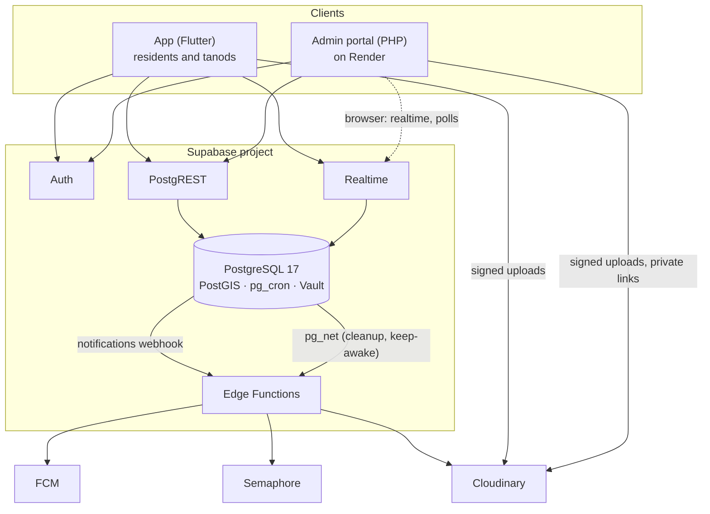

# Architecture

How SmartSumbong is put together, for whoever maintains it next. The README
says what the system does; this file says how. The schema itself is in
[schema.md](schema.md), production in [OPERATIONS.md](OPERATIONS.md).

## The shape of it



There are two clients and one source of truth. **The database is the
application**: the business rules live in PostgreSQL functions, row-level
security (RLS) decides who sees what, and pg_cron runs the clock. The portal
and the app render screens and call functions; neither can do anything the
database would refuse.

## The database

### Every change is a function

A complaint's status is never changed with a bare `UPDATE`. Each action
(`review_report`, `admin_dispatch`, `accept_dispatch`, `submit_field_report`,
`approve_resolution`, `escalate_in_barangay` …) is one function that, in one
transaction:

1. checks the caller may do it (role, case handler, current state);
2. changes the rows;
3. appends to `status_logs`, the audit trail;
4. writes the notifications for the people involved.

Most are `security definer`, because `notifications` and `status_logs` have
no insert policy for anyone: the only way to write them is through a
function that has already checked the caller. [schema.md](schema.md) lists
them by who calls them.

### Row-level security

Every table has RLS on. Policies use `(select auth.uid())` and helpers such
as `is_admin()` evaluated once per query (0061). In short:

- a **resident** sees their own account and complaints, and the public
  incidents an admin chose to publish (category, status and place only);
- a **tanod** sees their own dispatches and what those dispatches need;
- an **admin** has a tier (0145):
  - a **super admin** sees and changes everything, and sets up committees and
    who sees what (at Barangay 183: the barangay's IT admin, the Chairperson,
    and the development team, marked `is_dev`);
  - a **committee** admin sees only the categories its committee ticked (a case
    with a concern in them too, and any case it handles), and works those cases;
    the barangay-wide numbers and the settings are not for it;
  - a **captain** sees everything and changes nothing.

  Every admin can act on a case only while handling it (0087, enforced by
  triggers on everything an admin action writes). The tier is enforced in the
  database: reports and the 18 tables that hang off a report are read through
  `admin_sees_report()`, every case write passes `_scope_guard()` (also from
  `_case_guard`), the functions are grouped (settings for super admins, the
  analytics for super admins and captains, the case actions for those who can
  write the case), and a committee admin is never notified about a case
  outside its scope. Committees are a table a super admin edits
  (`committee_save`, `committee_set_categories`); `set_admin_access` sets a
  tier, and there is always at least one super admin.

The portal sends every request with the signed-in admin's own access token,
so RLS applies to the portal exactly as to the app. Nothing outside the Edge
Functions and the one-off scripts holds the service-role key.

### The audit trail

`status_logs` and `account_audit` are append-only and hash-chained (0015):
each row carries a hash of its content and of the row before it, per
complaint. `verify_report_trail()` (0082) recomputes the chain, so an edit or
a deletion made behind the functions' back shows up. Complaints themselves
are only ever soft-deleted (`deleted_at`).

### The clock

pg_cron runs the scheduled work (times in UTC; the barangay is UTC+8):

| Job | When | Does |
|---|---|---|
| `sweep-overdue-verifications` | every 10 min | flags registrations past the 2-hour review window |
| `sweep-unaccepted-dispatches` | every 5 min | a dispatch not accepted in time goes back to the system |
| `sweep-awaiting-units` | every 2 min | re-offers jobs that found no free tanod |
| `sweep-overdue-reports` | every 15 min | one "overdue" alert per missed deadline |
| `sweep-admin-handovers` | hourly | expires unanswered admin handovers |
| `smart-watch` | every 5 min | SMART's watcher: urgent cases nobody dispatched, deadline risk, spikes, quiet cases |
| `smart-morning-digest`, `smart-afternoon-digest`, `smart-night-digest` | 07:00, 14:00, 20:00 PH | the three briefings to every admin |
| `system-health` | hourly | failed jobs, database size, cleanup misses, function failures → alerts |
| `keep-portal-awake` | every 10 min | pings the portal (`/admin/ping.php`) and records uptime |
| `purge-old-notifications` | daily | read notifications go after 90 days, any after a year (0115) |
| `media-cleanup` | daily | asks the `media-cleanup` function to delete identity photos no longer used |

A GitHub Action (`keep-supabase-awake.yml`) makes one harmless request a day
so the free plan never pauses the project.

### SMART

The SMART engine (0121–0131) is SQL: rules, word lists and plain statistics,
no model. `smart_triage()` scores each complaint 0–100 with its reasons and
keeps the result in `report_triage`; triggers re-score when a report, or one
near it, changes. Around it sit duplicates, tanod ranking, overrides with
reasons, patterns, storm mode, deadline risk, learning new words (an admin
approves each), the priority queue and the briefings. The phone's OCR only
*reads* an ID; the rules that judge it run on the server (0126).
[SMART.md](SMART.md) explains every rule; [SMART_SCREENS.md](SMART_SCREENS.md)
where each shows.

### Geography

PostGIS holds the barangay boundary (OSM relation 2988704), each complaint's
point (`reports.geom`, generated from latitude and longitude), the NOAH flood
and storm-surge zones (0121, subdivided so a point lookup costs about 0.1 ms)
and the landmarks. Hotspots, distance-based tanod ranking and "is this inside
a hazard zone" are queries, not client code.

## Edge Functions

Five Deno functions in `supabase/functions`, each a `handler.ts` (the logic,
tested by `handler.test.ts` with every outside call stubbed) behind a
one-line `index.ts`. `supabase/config.toml` pins whether each checks the
caller's JWT.

| Function | Called by | Does |
|---|---|---|
| `send-dispatch-push` | the Database Webhook on `notifications` inserts | sends the phone banner through FCM, reading the notification as stored (a forged call cannot choose the text) |
| `sign-upload` | the app | signs a Cloudinary upload (SHA-256) within per-address limits; signs a viewing link for the caller's own private ID photo |
| `password-otp` | the app, signed out or in | SMS codes for a forgotten password and for moving to a new number; hashed, 10 minutes, 5 tries, 3 an hour |
| `delete-account` | the app | finishes the caller's own account deletion (0045): removes the sign-in entirely, or, when their complaints must stay on record, keeps the scrubbed profile and bans the sign-in |
| `media-cleanup` | pg_cron, with a secret from Vault | deletes identity photos from Cloudinary a week after nothing uses them |

## The admin portal

PHP 8.5 with no framework, no Composer and no build step: what is in `admin/`
is what runs. The Docker image (`Dockerfile`) is PHP's Apache image with curl
and mbstring, OPcache, and only `admin/`, `index.php` and `.htaccess` copied
in.

```
admin/<page>.php         one file per screen: reads, then renders
admin/includes/
  config.php             .env / environment, security headers, the CSP and its nonce
  supabase.php           the REST client: GoTrue and PostgREST over one pooled HTTP/2 connection
  auth.php               the session: tokens, refresh, idle sign-out, admin-only door
  layout.php             the shell: sidebar, header, toasts, the page's live token
  i18n.php               t('English', 'Tagalog'): every string in both languages
  case_actions.php …     page logic too big for its page
admin/assets/            css, js (one file per feature), icons, fonts, map styles and data, vendor/
```

**Requests.** A page calls `require_admin()`, which refreshes the access
token when it is near expiry, then reads what it needs from PostgREST (in
parallel where it can) with that token, and renders HTML. Forms post back to
the page, which calls the database function and redirects. Small JSON
endpoints (`board-act.php`, `widgets.php`, `workspace-act.php`, `token.php`,
`geocode.php`, `hazards.php`) serve the scripts; writes check a CSRF token.

**Live screens.** The browser opens Supabase Realtime and polls with the
admin's token; `token.php` hands out a fresh one before the page's runs out.

**Content-Security-Policy.** Every response carries a strict policy: scripts
run only with the request's random nonce, which the server stamps onto each
`<script>` as the page goes out; inline event handlers are refused
(`data-autosubmit`, `data-native-confirm` and `data-confirm` in `p.js` do
their jobs). A new outside service has to be added to the policy in
`config.php`. CI fails a page that serves a script without the nonce or an
inline handler.

**Languages and themes.** Every string goes through `t(en, fil)`; CI checks
each English string has its Tagalog. Light and dark themes are token sets
in CSS; the choice is kept per browser.

**Outside data.** Weather, air quality, tides and quakes (Open-Meteo, PHIVOLCS, USGS),
PAGASA and GDACS hazard feeds, OpenStreetMap layers and RSS are read on the
server, cached in the temp directory, and guarded against redirects to
private addresses (`feeds.php`). When the server's request is refused, the
weather widgets ask the same public API from the browser.

## The app

One Flutter app, `mobile/resident`, for residents and tanods; the role picked
at sign-in switches the screens (`AppRoleController`), the theme (navy for
residents, ink for tanods) and the bottom bar. `mobile/core` is the shared
package: sign-in and session storage in the OS keystore, uploads with EXIF
stripped, push, biometrics, OCR, the offline cache.

```
lib/main.dart            start-up: Firebase, Supabase, the launch gate, routes, the tablet frame
lib/screens/             resident screens (and the shared ones: sign-in, settings, profile)
lib/tanod/               tanod screens: home, dispatch order and window, navigation, history
lib/d/                   the design system (DColors, DPage, DCard, DButton …)
lib/outbox.dart          complaints filed without signal, sent when the phone reconnects
lib/preview/             an in-memory backend: the real screens on demo data (main_preview.dart)
```

**Sign-in by mobile number.** The identity is the phone number; Supabase Auth
sees a derived address on a reserved domain
(`639XXXXXXXXX@auth.smartsumbong.local`) that can receive no mail and cannot
be enumerated (0021). Password resets go through the barangay counter, or by
SMS code where switched on.

**Offline.** Screens open on their last saved copy (`json_cache`) and refresh
when they can; a complaint filed with no signal waits in the outbox and is
filed exactly once when the phone reconnects (`file_report` is safe to
resend, 0066).

**Location.** A tanod's location is taken at key moments only (going on duty,
returning to the app, each dispatch step, starting navigation). There is no
live tracking and no history.

**Configuration.** `dart_defines.json` (committed) holds the public client
values: the Supabase URL and publishable key, the Cloudinary cloud and
presets. Feature switches are constants (`kIdOcrEnabled`,
`kSmsResetEnabled`).

## Media

Photos and video go to Cloudinary, never through the database. Uploads are
signed (SHA-256) by `sign-upload` for the app and by the portal itself;
unsigned presets remain only as a fallback for older builds. Identity photos
are *authenticated* assets: their stored address opens nothing, and a
viewing link is signed each time one is shown (0117). Folders are pinned per
purpose (0083), and the database refuses media addresses outside them.

## What runs where

| Part | Where | Deployed by |
|---|---|---|
| Portal | Render web service `smartsumbong-ph`, Singapore | Manual Deploy on Render after a merge |
| Database, Auth, Realtime | Supabase `xmkpokcnjzgxgwysperh`, Mumbai | Actions → Deploy (`supabase db push`) |
| Edge Functions | the same Supabase project | Actions → Deploy |
| App | testers' and staff phones | an APK built from `mobile/resident` |
| CI, security scans, nightly backup | GitHub Actions | on push, pull request and schedule |

[DEPLOY.md](../DEPLOY.md) sets each up from nothing; [OPERATIONS.md](OPERATIONS.md)
covers running them.
