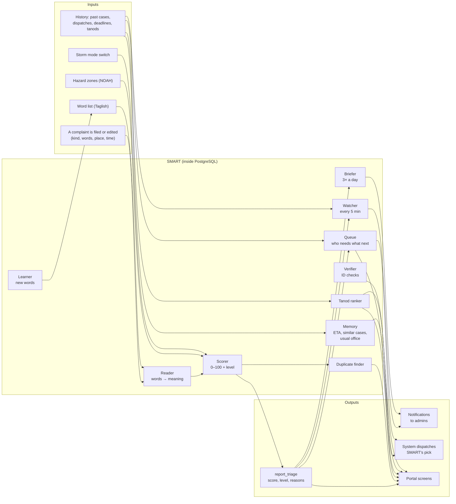
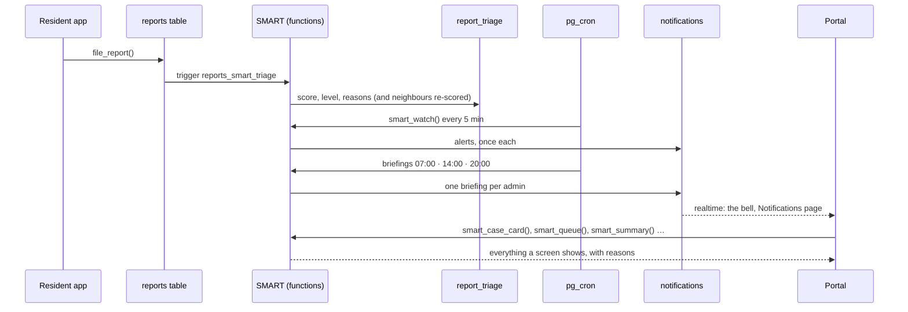

# The SMART engine

The part of SmartSumbong that reads every complaint, decides how urgent it
is, remembers what happened before, watches the clock, and tells the
barangay what needs doing next. This document describes it as an engine: its
parts, what goes in and what comes out, what the first version contains, how
it connects to the rest of the system, and what could be added for a
different client.

For the exact rules and numbers, see [SMART.md](SMART.md). For where each
part shows on screen, see [SMART_SCREENS.md](SMART_SCREENS.md).

Status: version 1, live since 14 October 2026 (migrations 0121–0131 on
production, 103 database checks in `supabase/tests` 04–13).

---

## 1. What it is, in one paragraph

SMART is a **rule-based decision engine** that runs inside the database. It
does not use AI or a trained model: every result comes from rules the
barangay can read, test and change, and **every result carries its
reasons** ("fire (sunog) +30, high flood zone +15, two neighbours reported
it +16"). It **advises; people decide**. It never closes, rejects, merges or
escalates a case on its own; an administrator acts, and when they disagree
with SMART they override it with a reason, which is kept. The one thing it
does by itself is choose the order, and who goes, for jobs the system was
already allowed to send by itself (section 4.5).

Three principles hold across every part:

| Principle | What it means in practice |
|---|---|
| **Explainable** | No score without its reasons. The case card, the queue and every alert say *why*. |
| **People decide** | Scores, flags and rankings are suggestions. Overrides need a reason and are kept. |
| **A model may read, rules decide** | If an AI or OCR step is ever used, it only *reads* (an ID, later perhaps a photo). The judgement is always a rule on the server. |

---

## 2. The engine at a glance

Think of it as four stages:

1. **Intake.** A complaint arrives. A database trigger hands it to the
   engine the moment it is written, and again whenever its kind, words or
   place change.
2. **Judgement.** The *reader* turns resident Taglish into known words; the
   *scorer* adds up points for the kind, the words, the hazard zone, the
   neighbours and the hour; the *duplicate finder* looks for the same
   problem filed before.
3. **Memory and watch.** The engine keeps what it learned (scores,
   overrides, alerts already sent, words taught) and looks at the whole
   barangay on a timer: what is waiting too long, what is about to miss its
   deadline, what keeps coming back, what is spiking.
4. **Output.** Scores and reasons in `report_triage`; alerts and briefings
   as notifications to administrators; an order for the work (the queue);
   SMART's choice of tanod for the system's own dispatches; and everything
   the portal draws.

---

## 3. What is inside version 1

Version 1 is eleven migrations, built and tested on 10 October 2026 and put
on screen on 14–16 October.

| # | Part | Migration | What it does | Where it shows |
|---|---|---|---|---|
| 1 | **Hazard map in the database** | 0121 | The NOAH flood and storm-surge zones, stored so a point lookup costs about 0.1 ms | Feeds the scorer; the map's flood layer |
| 2 | **Scorer (triage)** | 0122 | A 0–100 urgency score and a level (urgent / high / normal / low) for every complaint, with reasons | Case Reports' SMART column, the case card |
| 3 | **Duplicate finder** | 0122 | Earlier open complaints that are probably the same problem (same kind, close, recent, worded alike) | The case card |
| 4 | **Tanod ranker** | 0122 | Who to send, best first: distance, jobs in hand, cases closed nearby, how old their location is | The assign form, the roster |
| 5 | **Usual time (ETA)** | 0122 | How long this kind of complaint usually takes *here* (median and slow case) | The case card |
| 6 | **Overrides, patterns, watcher, calibration** | 0123 | Admins raise or lower a level with a reason; recurring problems at one spot; alerts for urgent cases nobody sent; how the rules compare with people's judgement | The case card, the map, notifications, Settings → SMART |
| 7 | **Screens' calls** | 0124 | One call per screen: the case card, the dashboard tiles, *Try it* (score a sample complaint without saving) | Dashboard, Settings → SMART |
| 8 | **Reader (Taglish)** | 0125 | Tagalog word forms, texting spellings, synonyms, negation ("walang sunog" is not a fire), one-letter slips | Everywhere words are scored; *Try it* shows the reading |
| 9 | **Verifier (ID checks)** | 0126 | The phone's OCR only reads an ID; the server checks the type, the name, the number's shape and reuse on another account | Built, waiting for ID reading to be switched on |
| 10 | **Foresight** | 0127 | Storm mode, deadline risk, spikes, similar past cases and the usual office, the morning digest | Settings, dashboard, case card, notifications |
| 11 | **Learning and routing** | 0128 | Words residents use that SMART does not know (an admin teaches each one), quiet cases, the week's patterns, the on-time scorecard, SMART's pick for the system's dispatches | Dashboard scorecard, notifications, dispatch instructions |
| 12 | **The queue** | 0129 | Every open case in one order by what it needs and how badly; the dispatch waiting line in that order | Case Reports' *Next up*, the Workspace |
| 13 | **Three briefings** | 0131 | Morning (07:00), afternoon (14:00) and night (20:00) summaries to every administrator | Notifications, the Workspace briefing bar |

What a resident or a tanod sees of all this: **nothing**. Residents never
see a score; tanods only see SMART's one-line reason when the *system*
dispatched them ("SMART pick: 330 m away, 0 jobs in hand, 2 cases closed
nearby").

---

## 4. Each part, as a component

### 4.1 Reader

**Input:** the complaint's subject and description. **Output:** the words as
SMART understands them.

Each word goes through, in order: is it a known word; is it in the word list
(a texting spelling, a synonym, an irregular form); can grammar reduce it to
a known word (prefixes *na-, nag-, ma-, naka-*, infixes *-um-, -in-*,
suffixes *-an, -in*, the repeated first syllable, the linker *-ng*); is it
one letter from exactly one known long word. So *nasusunog → sunog*, *binaha
→ baha*, *snog → sunog*, *garbage → basura*. Negation (*walang, hindi, di,
huwag, no, not, never, without*) cancels the next two words until a comma,
full stop or *pero/but*.

**Limit:** it reads words, not sentences. "Usok lang galing sa ihawan" still
counts the smoke. That is why reasons are shown and admins can override.

### 4.2 Scorer

Adds points, caps at 100, sets a level:

| Factor | Points |
|---|---|
| Kind of complaint | public safety 35, peace and order 30, environment and waste 25, traffic 20, obstruction 20, animals 15, barangay service 10, other 10 |
| Danger words, each group once (45 at most) | fire, weapon, injury, gas leak 30; live wire, collapse, accident 25; fight 20; flooding 15; child, elderly, pregnant, PWD 10 |
| Inside a NOAH hazard zone | low +5, medium +10, high +15 |
| Other residents reporting the same within 150 m and 48 h | +8 each, 24 at most |
| Filed 22:00–05:00 (safety kinds) | +5 |
| Storm mode on | hazard points and flood / live-wire / collapse words count double |

Urgent from 70, high from 45, normal from 25, otherwise low.
*"May sunog sa likod ng bahay, may bata sa loob"* scores 35 + 30 + 10 = **75,
urgent**. A broken rule never blocks filing: the complaint is filed and simply
not scored.

### 4.3 Duplicate finder

Earlier **open** complaints of the same kind within 100 m and 72 hours that
are worded alike (trigram similarity 0.3+, on the words as written *and* as
SMART reads them) or within 25 m. Up to five, each with distance, hours apart
and similarity. **Nothing is merged automatically.**

### 4.4 Memory

- **Usual time:** median and 80th percentile of how long this barangay took
  for this kind over 180 days (the SLA target until there are 5 closed cases).
- **Similar past cases:** up to three finished cases most like this one, and
  how each ended (office, remark, field report, days).
- **Usual office:** "Usually referred to City Veterinary Office (3 of 3)".
- **What was already said:** every alert is sent once (`smart_patterns_seen`).
- **Overrides:** every raise, lower or clear, with the score of that moment.

### 4.5 Tanod ranker and router

Each available tanod starts at 100: −1 per 20 m (50 at most), −15 per job in
hand, +5 per case closed within 300 m in 90 days (20 at most), −10 if their
location reading is stale. The admin sees the ranking and chooses.

When the **system** dispatches by itself (a job handed back, not accepted in
time, or sent "back to the system"), it takes SMART's first choice instead of
the nearest tanod. The choice is from exactly the same tanods as before; only
the order changed. A switch (`smart_routing`) restores nearest-only.

### 4.6 Watcher

Runs every 5 minutes (`smart-watch`) and tells administrators, once each:

- an **urgent** complaint with no tanod after 15 minutes, a **high** one after 60;
- a **recurring problem** it has not seen before (3+ reports of one kind
  within 60 m, in 2+ different weeks, over 90 days);
- a case that will probably **miss its deadline** (from the usual time and the
  tanod's load);
- a **spike** (a kind well above its usual week, with the place it is coming from);
- a **quiet case** (no update of any kind for 3 days).

### 4.7 Queue

Every open case, in one order:

| Part | Points |
|---|---|
| Urgency | the SMART score (or the admin's level: low 10, normal 35, high 55, urgent 80) |
| Waiting at its current stage | 1 an hour, 40 at most |
| Past its deadline | +20 |
| Likely to miss it | +15 |
| Quiet for days | +10 |

Each case also gets its **next action**: decide an escalation, approve a
resolution, review, assign, wait for the tanod, reply to the resident, follow
up. Waiting time keeps it fair (a low case gains a point an hour, so it never
waits forever), and the cap keeps a fresh urgent case first. When no tanod is
free, the dispatch waiting line now follows this order instead of first come,
first served (switch: `smart_queue`).

### 4.8 Learner

Lists words residents keep using (3+ reports in 30 days) that SMART does not
know, with the kind they come with and a likely spelling. An administrator
teaches each one in a single step (as a spelling, synonym or form; as a word
of a kind; as an urgent word) or dismisses it. Open complaints are re-scored
at once. **A person approves every word**; nothing is learned silently.

### 4.9 Briefer

Three short notifications a day to every administrator: the morning (what is
open, waiting, overdue, due today, at risk, filed yesterday, recurring, the
top spike, storm mode), the afternoon (the day so far) and the night (the day
read back). Each can be previewed in Settings and switched off.

### 4.10 Verifier

For account registration, when ID reading is switched on: the phone reads the
ID with on-device OCR and sends only what it read. The server checks the ID
type, the name against the registered name (forgiving OCR's digit-for-letter
slips), the number's shape for that ID type, and whether the number is on
another account. Result: problem / check / ready / no reading, with reasons
beside the photo. **A reading never verifies anyone**: the admin always looks
at the photo.

### 4.11 Calibration

How the rules compare with people: for each level and each factor, how many
complaints it touched, how often admins raised or lowered it, and the time to
first dispatch and to resolution. If a factor keeps appearing in complaints
admins lower, it is worth too many points. **People change the rule, not the
engine.**

---

## 5. How it connects to the backend today

**Where it lives.** Entirely in PostgreSQL (Supabase), as SQL functions,
tables and one trigger. There is no separate server, no queue service, no
model to host. If the database is up, SMART is up.

**What it reads.** `reports` (kind, words, point, time, status), `hazard_zones`,
`smart_lexicon`, `smart_rules`, `dispatches` and `status_logs` (history,
loads, deadlines), `users` (tanods' duty status and last location reading),
`report_messages` and `dispatch_updates` (to know when a case went quiet).

**What it writes.** `report_triage` (one row per complaint), `smart_overrides`,
`smart_patterns_seen`, `smart_word_decisions`, `smart_lexicon` (only when an
admin teaches a word), `notifications` (alerts and briefings), and the tanod
and instructions of a *system* dispatch.

**Hooks into the rest of the system.**

| Hook | What happens |
|---|---|
| Trigger `reports_smart_triage` | After a complaint is inserted, or its kind, subject, description or place changes: score it and its open neighbours |
| `auto_dispatch` / `sweep_awaiting_units` | The system's own dispatches use SMART's tanod pick and the queue order |
| pg_cron `smart-watch` | Every 5 minutes: the watcher |
| pg_cron `smart-morning-digest`, `smart-afternoon-digest`, `smart-night-digest` | The briefings |
| Portal pages | `case.php`, `cases.php`, `dashboard.php`, `spatial.php`, `settings.php`, `notifications.php` (through `briefing.php`), the Workspace (`board-act.php`, `widgets.php`) call SMART's functions through PostgREST with the admin's own token |
| The app | Calls nothing of SMART, except `submit_id_reading` when ID reading is on |

**Who may call it.** Administrators only (row-level security and checks
inside each function). Residents and tanods cannot read scores, rules or
overrides.

**Speed.** On 50,000 complaints packed into half a square kilometre (far
denser than the barangay): filing with scoring 36 ms, the case card 52 ms,
duplicates 6 ms, the watcher's main step 50 ms, the queue of 25,000 open cases
419 ms (a few ms at the barangay's real size). These are budgets CI enforces.

**Safety rails.** A broken rule never stops a filing. Every alert is sent
once. Every switch (storm mode, routing, queue order, digest) can be turned
off. Storm mode ends on its own.

---

## 6. What it can do for the barangay

In the questions a barangay secretary actually asks:

| Question | SMART's answer |
|---|---|
| "Which complaint first?" | The queue: one order, with the reason and the next action for each |
| "Is this one serious?" | The score and level, with every point explained |
| "Did someone already report this?" | Possible duplicates, with distance and wording |
| "Who should I send?" | The tanod ranking, with distance, load, local experience and location age |
| "How long will it take?" | The barangay's own usual time for this kind |
| "Where did a case like this go last time?" | Similar past cases and the usual office |
| "What am I forgetting?" | The watcher: urgent cases nobody sent, deadlines at risk, quiet cases |
| "Is something happening?" | Spikes and recurring problems, with places |
| "A typhoon is coming." | Storm mode: flood and danger factors double until it ends |
| "How are we doing?" | The scorecard: on-time share per kind, against last month |
| "When do these happen?" | The week: kinds by weekday and hour, with places, for patrol planning |
| "Residents write in Taglish and typos." | The reader, and the learner for new words |
| "Is this ID fake?" | The verifier's checks (when switched on), with the photo always shown |

---

## 7. What it cannot do (honestly)

- **Understand sentences.** It reads words and short phrases. Sarcasm,
  context and "it was just a grill" are beyond it.
- **See photos or video.** It counts nothing in them today.
- **Verify identity.** It flags mismatches; it cannot check with PSA or LTO.
- **Decide.** It never closes, rejects, merges or escalates by itself.
- **Know what it has not seen.** Usual times, spikes and patterns need the
  barangay's own history; a new barangay starts on the SLA targets.
- **Tune itself.** Calibration shows where rules disagree with people; a
  person changes the rule.

---

## 8. Tuning it for a barangay

Everything below is data, not code: an administrator changes it, then
`smart_retriage()` re-scores the open complaints.

| Setting (`smart_rules` …) | Controls |
|---|---|
| `category_points` | Points per kind of complaint |
| `keyword_groups`, `keyword_cap` | Danger word groups, their points, the cap |
| `hazard_points` | Points per hazard level |
| `corroboration_metres`, `_hours`, `_points`, `_cap` | How neighbours' reports back each other up |
| `night_points` | The night bonus |
| `urgent_from`, `high_from`, `normal_from` | Where the levels start |
| `duplicate_metres`, `_hours`, `_similarity` | What counts as a possible duplicate |
| `urgent_dispatch_minutes`, `high_dispatch_minutes` | When the watcher speaks up about an unsent case |
| `pattern_metres`, `_min_reports`, `_min_weeks`, `_days` | What counts as a recurring problem |
| `category_words` | Words per kind, for the category hint |
| `storm_mode`, `storm_until`, `storm_reason`, `storm_multiplier`, `storm_labels` | Storm mode |
| `spike_min_reports` | The smallest spike worth telling |
| `stuck_days` | When a case counts as quiet |
| `word_min_reports` | How often a new word must appear before it is suggested |
| `queue_aging_minutes`, `queue_aging_cap`, `queue_overdue_points`, `queue_risk_points`, `queue_quiet_points` | The queue's fairness |
| `digest_enabled`, `smart_routing`, `smart_queue` | The switches |

Plus three data sets: the **word list** (`smart_lexicon`: spellings,
synonyms, forms), the **hazard zones** (regenerated from NOAH's maps with
`supabase/tools/gen_hazard_zones.sh`) and the **kinds of complaint** with
their SLA hours (`sla_policies`).

---

## 9. What can be added, depending on the client

The engine was built so most growth is new rules or new signals on the same
frame: one more factor in the scorer, one more alert in the watcher, one more
call for a screen. What to add depends on who the client is.

### 9.1 For Barangay 183, next (already designed)

| Addition | What it gives |
|---|---|
| **Rule versions** | Every change to the rules and word list kept as a version with a reason; any version can be restored; each score remembers which rules made it |
| **Replay (backtest)** | "If we changed this rule, which of the last 90 days' complaints would move?" before changing it |
| **"Was it fixed?"** | The resident is asked after resolution; "no" brings the case back to the top of the queue |
| **Duty roster suggestion** | Expected complaints per weekday and 3-hour block against the tanods usually on duty, with the gap |
| **The screens still to build** | Words to learn, the week's patterns, the ID-check queue, the storm notice on every page |

### 9.2 For a flood- or typhoon-prone barangay

- **Automatic storm mode** from the PAGASA and GDACS feeds the Workspace
  already reads (a Red rainfall warning or Signal 3 turns it on, with the
  warning as the reason).
- **"Flooding now"**: a burst of flood reports in the last hour raises a
  banner for that purok.
- **Evacuation awareness**: complaints near a full or closed safe point
  (the Workspace already keeps their capacity) score higher.
- **Relief follow-up**: streets without a relief record during a calamity.

### 9.3 For a larger barangay or a whole city

- **Many barangays in one engine**: rules, word lists and hazard zones per
  barangay; a city view of spikes and recurring problems across boundaries.
- **Shadow rules**: a proposed rule set runs beside the live one for a week
  and is compared with administrators' overrides before it goes live.
- **Fairness checks**: response times by purok (equity), one tanod getting
  most of the week's jobs (fair load), one admin holding most of the queue.
- **Budget evidence**: per kind and quarter, counts, time and offices
  involved, as a printable sheet for the council.
- **Hotspot work orders**: a recurring problem becomes one "permanent fix"
  item, with its complaints as evidence.

### 9.4 For a client that wants more "intelligence"

Kept to the same line: **a model may read, rules decide.**

- **Photo checks without AI**: blank, dark or blurry photos; a photo reused
  from an old complaint (perceptual hash).
- **A model as a reader only**: a language model or classifier could
  *suggest* a kind or extra words, shown as a suggestion with its reason,
  never changing the score on its own; the same calibration measures it.
- **Feedback mood**: praise and complaint words in residents' ratings.

### 9.5 For residents (trust)

- "Is this the same as…?" at filing: join an existing nearby complaint.
- A completeness nudge before sending ("add a photo or a landmark").
- Plain-language status for each step, and "why this order?" in words,
  never scores.
- A weekly anonymous board of numbers per purok; a one-page monthly
  summary for the captain.

### 9.6 Integrations

- **SMS** (already built for passwords): urgent alerts to the on-duty
  administrator's phone when the portal is closed.
- **The barangay's Facebook page** (planned): posts read as a feed, so an
  announcement can explain a spike.
- **City or national systems**: referrals sent to the usual office
  electronically instead of by paper, where those offices accept it.

---

## 10. Glossary

| Term | Meaning |
|---|---|
| **Score** | 0–100, the sum of the points a complaint earned, capped |
| **Level** | urgent (70+), high (45+), normal (25+), low |
| **Reasons** | The list of factors and points behind a score |
| **Override** | An administrator setting a different level, with a reason |
| **Corroboration** | Other residents reporting the same kind nearby, recently |
| **Recurring problem** | The same kind at the same spot in different weeks |
| **Spike** | A kind well above its usual week |
| **Deadline risk** | A case that will probably miss its target date |
| **Quiet case** | An open case with no update for days |
| **Queue** | Every open case in one order, by urgency plus waiting |
| **Storm mode** | A switch that doubles flood and danger factors for a set time |
| **Word list (lexicon)** | Spellings, synonyms and forms SMART reads as known words |
| **Calibration** | Comparing the rules with people's overrides and outcomes |

---

## 11. Where it is in the code

| What | Where |
|---|---|
| The engine | `supabase/migrations/0121`–`0131` (SQL functions, tables, the trigger, the schedules) |
| Its tests | `supabase/tests/04_smart.sql` to `13_three_briefings.sql`; speed in `supabase/tests/perf/query_budget.sql` |
| The rules in plain words | [SMART.md](SMART.md) |
| Its screens | [SMART_SCREENS.md](SMART_SCREENS.md); `admin/case.php`, `cases.php`, `dashboard.php`, `spatial.php`, `settings.php`, `includes/briefing.php`, `assets/js/sd-smart.js`, `assets/js/smart-panel.js` |
| The schema it adds | [schema.md](schema.md), "SMART engine" tables and functions |
